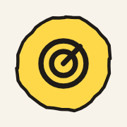
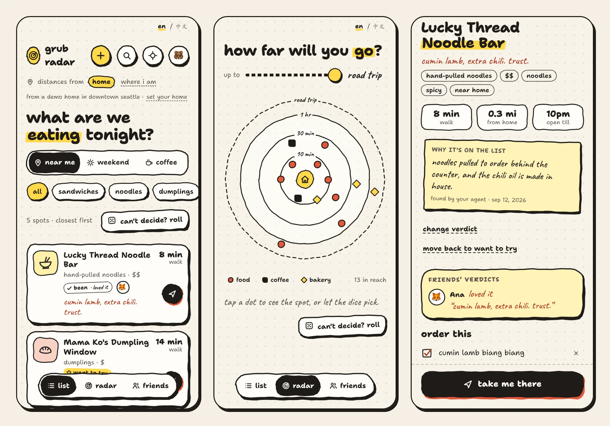

<p align="center">
  
</p>

<h1 align="center">grub radar</h1>

<p align="center">
  A hand-drawn radar of places to eat, sorted by how far they are from you.<br>
  Built for humans and their agents.
</p>

<p align="center"><a href="https://grub.shuaiyuan.me"><b>grub.shuaiyuan.me</b></a></p>

<p align="center">
  
</p>

## what it does

- **near me, weekend, coffee.** Your spots sorted closest first, from home or from where you
  are right now, with walk or drive minutes on every card. Or see them on the radar: rings
  are travel time, dots are spots.
- **add from Apple Maps.** Type a name or a craving ("pho"), tap a result, and it's on your
  list. Or add one by hand.
- **been / want to try.** Mark a place been with a verdict (loved it, it was fine, nope),
  keep a one-line note and what to order, then hit **take me there** for Apple Maps
  directions.
- **friends, by invite link.** Send a link, they accept, and you see each other's
  verdicts and faces on the places you share.
- **photos.** A few photos per spot, shrunk on your phone first.
- **can't decide? roll.** The dice picks something in reach.
- **connect your AI agent.** Claude, Codex, Cursor or your own bot can find, add and mark
  spots for you over MCP or REST, with your consent.
- **en / 中文**, phone first, with a proper desktop layout.

## privacy

- Your home never leaves your account. It isn't in the code or the config, and agents only
  ever get the centre of a ~1 km grid cell around it.
- Photos are re-encoded on your device and checked again on the server, so no GPS position
  or other metadata gets stored.
- Friends see only the spots you leave visible to friends: name, verdict and one-liner.
  Never your home or private notes. Any spot can be "just me".
- Your list is yours: every query is scoped to your account, and nothing is public. Signed
  out, you see a sign-in page and nothing else.

The details: [Privacy Policy](https://grub.shuaiyuan.me/privacy) ·
[Terms of Service](https://grub.shuaiyuan.me/terms).

## connect your agent

Point your agent at [grub.shuaiyuan.me/agent-setup.md](https://grub.shuaiyuan.me/agent-setup.md)
and it'll walk you through connecting (OAuth for MCP clients, or a personal token).

## built with

Cloudflare Workers, D1, R2 and KV · React · Sign in with Apple · Apple Maps.

## development

```sh
npm install
npm run dev:vars          # once: local secrets in .dev.vars
npm run db:migrate:local  # local D1
npm run apple-stub        # in another terminal: fake Sign in with Apple + Apple Maps
npm run dev               # http://localhost:5173
```

More in [`docs/`](docs/README.md):

- [architecture](docs/architecture.md): how the app and the Worker fit together, the UI
- [auth](docs/auth.md): Sign in with Apple, sessions, CSRF, who can sign up
- [agents](docs/agents.md): OAuth, MCP, personal tokens, scopes, home snapping
- [data](docs/data.md): D1 schema, migrations, R2 photos and the deletion outbox
- [api](docs/api.md): every endpoint
- [security](docs/security.md): the invariants and how they're tested
- [operations](docs/operations.md): deploys, secrets, rate limits, the KV budget, logs

Working in this repo with a coding agent? Start at [AGENTS.md](AGENTS.md).
